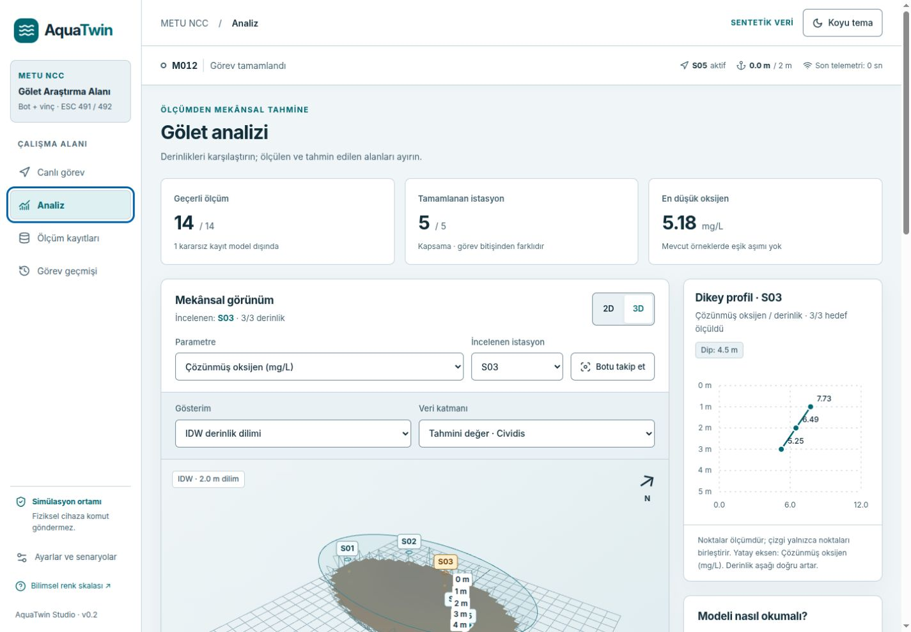
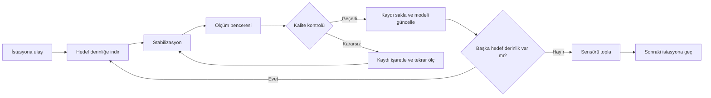
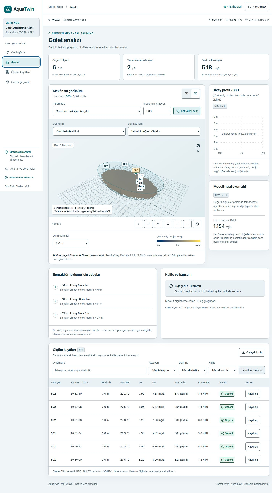

<div align="center">

# AquaTwin

### Yüzeyden derinliğe, ölçümden dijital ikize.

Bot ve vinç tabanlı **çok derinlikli su kalitesi izleme** için etkileşimli bir araştırma arayüzü.


[Genel bakış](#genel-bakış) · [Ekranlar](#ekranlar) · [Kurulum](#hızlı-başlangıç) · [Mimari](#mimari) · [Araştırma](RESEARCH.md)

</div>

---

## Ekip üyeleri ve AI ile geliştirme

**Başlangıç noktası: [AGENTS.md](AGENTS.md).** Mevcut mimari, tamamlanan işler, kararlar, clone sonrası kurulum, testler ve sıralı sonraki geliştirmeler [AI devir rehberinde](docs/AI_HANDOFF.md) açıklanır. Repoyu başka bir AI'a verirken önce bu iki dosyayı okumasını isteyin. Claude ve Copilot için de aynı rehbere yönlendiren giriş dosyaları vardır; her aracın otomatik dosya okuma desteği farklı olabilir.

## Genel bakış

**AquaTwin**, METU NCC göletinde farklı konum ve derinliklerden toplanacak su kalitesi ölçümlerini incelemek için geliştirilen bir **React + Three.js** prototipidir.

Tasarımın merkezinde bir su üstü botu ve bot üzerindeki vinç bulunur. Bot örnekleme istasyonuna ulaşır; sensör podu sırasıyla hedef derinliklere indirilir. Her derinlikte stabilizasyon ve ölçüm aşamaları tamamlanır, ardından sensör toplanarak sonraki istasyona geçilir.

Arayüz bu süreci **canlı görev görünümü**, **3D gölet modeli**, **dikey profiller**, **mekânsal analiz** ve **incelenebilir ölçüm kayıtları** üzerinden birleştirir.

> **Mevcut durum:** İki çalışma alanı vardır: tarayıcı içi sentetik demo ve FastAPI/PostgreSQL üzerinden kalıcı ölçüm okuyan API alanı. Harici örnek göndericiyle backend → veritabanı → tablo/3D akışı uygulanmıştır. Fiziksel bot/vinç kontrolü ve gerçek sensör sürücüleri henüz yoktur. Gölet geometrisi ve batimetri şematiktir.

<p align="center">
  
</p>

## Örnekleme akışı



Demo, **beş istasyonda 1, 2 ve 3 metre** hedeflerini kullanır. Sığ istasyonda dip mesafesine uymayan hedef atlanır; toplam **14 geçerli ölçüm** hedeflenir. Başlangıçta ilk iki istasyonun altı ölçümü yüklüdür.

- Sensör toplanmadan istasyonlar arası hareket başlatılmaz.
- Demo dip mesafesi **0,4 m** olarak tanımlıdır; sahada doğrulanmış bir işletim limiti değildir.
- Demo bekleme süreleri **5 saniye stabilizasyon + 3 saniye ölçüm** şeklindedir; gerçek probların sürelerini temsil etmez.
- Kararsız kayıt silinmez; modelden çıkarılır ve kullanıcı tekrar ölçüm başlatabilir.

## Neler sunuyor?

| Çalışma alanı | Özellikler |
| --- | --- |
| **Canlı görev** | Sürekli görünür görev durumu, aktif istasyon, vinç derinliği, aşama geri sayımı, telemetri yaşı ve olay günlüğü. |
| **Gölet analizi** | Döndürülebilen 3D model, 2D üstten görünüm, derinlik dilimi, dikey kesit ve istasyon profili. |
| **Mekânsal modelleme** | Gerçek IDW hesabı, görev içi leave-one-out RMSE, örnekleme uzaklığı ve önceki göreve göre tahmin farkı. |
| **Ölçüm kayıtları** | İstasyon/derinlik/kalite filtreleri, sütun sıralama, tek kayıt ayrıntısı ve filtrelenmiş CSV. |
| **Kalite incelemesi** | Ham DO penceresi, 30 sentetik örnek, standart sapma, kalite nedeni ve kalibrasyon metaverisi. |
| **Görev geçmişi** | İki tamamlanmış sentetik görev ve kayıtların zaman sırasıyla açıldığı replay. |
| **Hata senaryoları** | Bağlantı kesilmesi, vinç hatası, kararsız ölçüm ve kullanıcı kontrollü toparlanma. |
| **Kullanılabilirlik** | Açık/koyu tema, mobil düzen, klavye ile kamera kontrolü, görünür odak ve hareket azaltma. |

**İnceleme kontrolü kullanıcıda kalır:** Botun aktif istasyonu ile incelenen istasyon ayrıdır. Otomatik geçiş yalnızca **Bot takibi açık** olduğunda yapılır.

**Yerel kayıtlar korunur:** Görev durumu bu tarayıcıda saklanır. Tamamlanmamış bir görev sayfa yenilendiğinde otomatik hareket ettirilmez; duraklatılarak geri yüklenir. Sıfırlamadan önce CSV indirme seçeneği sunulur.

## Ekranlar

Her bağlantı gerçek arayüzün tam uzunluktaki ekran görüntüsünü açar.

| Canlı görev | Analiz | Ölçüm kayıtları | Görev geçmişi | Ayarlar |
| :---: | :---: | :---: | :---: | :---: |
| [Görüntüle](docs/images/live-mission.jpg) | [Görüntüle](docs/images/analysis.jpg) | [Görüntüle](docs/images/measurements.jpg) | [Görüntüle](docs/images/history.jpg) | [Görüntüle](docs/images/settings.jpg) |

<details>
<summary><strong>3D analiz ekranını tam uzunlukta görüntüle</strong></summary>
<br>

</details>

## Hızlı başlangıç

### Gereksinimler

- **Node.js 20 veya üzeri** ve npm.
- 3D görünüm için WebGL destekli modern bir tarayıcı.
- Private repoyu klonlamak için GitHub erişimi ve aşağıdaki SSH komutuna uygun bir SSH anahtarı.

```bash
git clone git@github.com:bugractnky/aquatwin-studio.git
cd aquatwin-studio
npm ci
npm run dev
```

Vite'ın terminalde gösterdiği yerel adresi açın. Varsayılan adres `http://127.0.0.1:5173` olur; port doluysa Vite başka bir port seçebilir.

**Demo modu** için API anahtarı, veritabanı veya `.env` gerekmez. **API çalışma alanı** için [backend kurulumunu](backend/README.md) tamamlayın. Arayüzdeki **API çalışma alanı** düğmesi kalıcı görev ve ölçümleri açar; API kapalıyken demo verisine dönmez.

Kararlar ve yapılan geliştirmeler: [DEVELOPMENT_DECISIONS.md](DEVELOPMENT_DECISIONS.md). Ölçüm sözleşmesi: [docs/MEASUREMENT_CONTRACT.md](docs/MEASUREMENT_CONTRACT.md).

### İlk deneme

1. **Canlı görev** ekranında demoyu başlatın.
2. Vinç derinliğini ve stabilizasyon/ölçüm aşamalarını izleyin.
3. Başka bir istasyon seçin; bot ilerlerken seçiminizin korunduğunu kontrol edin.
4. **Analiz** ekranında parametreyi, derinliği ve IDW katmanını değiştirin.
5. **Ölçüm kayıtları** ekranında bir kaydı açarak ham pencereyi ve kalite bilgisini inceleyin.
6. **Ayarlar ve senaryolar** ekranından hata senaryolarını deneyin.

### Komutlar

| Komut | Açıklama |
| --- | --- |
| `npm run dev` | Yerel geliştirme sunucusunu başlatır. |
| `npm run build` | Üretim dosyalarını `dist/` klasörüne derler. |
| `npm test` | Model ve temel renk karşıtlığı testlerini çalıştırır. |

## Kalıcı görev planlama

API çalışma alanında ayrı operatör oturumuyla görev, sıralı istasyonlar, konumlar ve hedef derinlikler oluşturulabilir. Planlar PostgreSQL'de saklanır, ilk ölçüme kadar sürüm kontrollü düzenlenebilir; ölçümden sonra geçmişi korumak için kilitlenir. Plan/ölçüm tablosu hedef ile ölçülen derinliği ayrı gösterir. Plan kaydetmek fiziksel hareket başlatmaz.

Operatör girişi için backend'de `AQUATWIN_OPERATOR_PASSWORD` gerekir; cihaz token'ı tarayıcıya konulmaz. Kurulum ve API: [Görev planlama rehberi](docs/MISSION_PLANNING.md). [Yeni doğrulama kaydı](docs/VALIDATION_MISSION_PLANNING.md).

## İzlenen parametreler

| Parametre | Alan | Birim |
| --- | --- | --- |
| Su sıcaklığı | `temp` | °C |
| pH | `ph` | Birimsiz |
| Çözünmüş oksijen | `do` | mg/L |
| Elektriksel iletkenlik | `ec` | µS/cm |
| Bulanıklık | `turb` | NTU |
| Örnekleme derinliği | `depth` | m |

Her kayıt ayrıca görev/istasyon kimliğini, zamanı, yerel konumu, örnek sayısını, kalite durumunu ve sensör metaverisini taşır. Arayüz saatleri **Türkiye saatiyle**, CSV zamanları **ISO UTC** biçiminde gösterilir.

## Mimari

```text
src/
├── SourceApp.jsx           Demo/API çalışma alanı seçimi
├── ApiWorkspace.jsx        Kalıcı görev ve ölçüm görünümü
├── OperatorAccess.jsx      Ayrı operatör oturumu
├── PlanEditor.jsx          Görev/istasyon/derinlik planı formu
├── MissionPlan.jsx         Plan ve ölçüm karşılaştırması
├── planning.js             Plan doğrulama ve API işlemleri
├── api.js                  API sözleşmesi ve görüntüleme adaptörü
├── App.jsx                 Çalışma alanları ve ortak arayüz durumu
├── Twin.jsx                Three.js sahnesi, bot/pod ve mekânsal katmanlar
├── components.jsx          Profil, kayıt tablosu ve ayrıntı pencereleri
├── useMission.js           Görev akışı, yerel kayıt ve hata senaryoları
├── model.js                Sentetik ölçümler, durum makinesi, IDW ve CSV
├── palettes.js             Cividis ve fark skalası renk tabloları
├── style.css               Temalar, erişilebilir kontroller ve responsive düzen
├── model.test.js           Model ve görev davranışı testleri
└── accessibility.test.js   Temel semantik metin karşıtlığı testleri
```

**React** arayüzü yönetir; **Three.js** mekânsal görünümü çizer. DOM'dan bağımsız model fonksiyonları test edilebilir. Three.js sahnesi gerektiğinde dinamik yüklenir. Sistem fontları kullanılır; uygulama çalışma sırasında harici font veya CDN gerektirmez.

WebGL kullanılamadığında istasyon seçicisi, profil ve tablo aynı ölçüm verilerine erişim sağlar.

## Bilimsel tasarım ve model sınırları

Veri renkleri ile arayüz durum renkleri birbirinden ayrıdır. Sayısal büyüklüklerde **Cividis**, iki görev arasındaki işaretli farkta sıfır merkezli mavi/kırmızı skala kullanılır. Gösterge ve sahne aynı renk fonksiyonundan beslenir; parametre sınırları görevler arasında sabit kalır.

Araştırma dayanakları ve tasarım kararları: **[RESEARCH.md](RESEARCH.md)**.

| Konu | Bu sürümdeki anlamı |
| --- | --- |
| **IDW** | Geçerli ölçümlerden gerçekten hesaplanır; ters mesafe kuvveti 2'dir. |
| **Derinlik ağırlığı** | Mesafede 8× kullanılır. Saha verisiyle ayarlanması gereken demo tercihidir. |
| **RMSE** | Sentetik görev içi nokta bırakma değerlendirmesidir; gerçek saha başarımı kanıtı değildir. |
| **Örnekleme uzaklığı** | En yakın örneğe ölçekli uzaklıktır; istatistiksel belirsizlik veya güven aralığı değildir. |
| **Örnekleme adayları** | Seyrek örneklenen bölgeleri işaretler; rota, enerji veya engel optimizasyonu yapmaz. |
| **Geçmiş replay** | Kayıtları sırasıyla açar; gerçek tarihsel bot rotasını yeniden oynatmaz. |
| **DO dikkat eşiği** | Kullanıcı tarafından değiştirilen bir demo eşiğidir; çevresel tanı veya mevzuat limiti değildir. |

Gerçek batimetri, GNSS koordinat dönüşümü, sensör kalibrasyonu, kablo uzunluğu ölçümü, MQTT ve GP/kriging bu sürümde uygulanmış değildir. API ve PostgreSQL bağlantısı uygulanmıştır. API alanı yalnız bilinen `demo-pond-v1` yerel koordinatlarını şematik sahneye koyar; coğrafi koordinatlı kayıtlar tabloda korunur. API alanında cihaz telemetrisi, bot hareketi ve interpolasyon katmanı henüz yoktur. Demo IDW özellikleri ayrı demo modunda korunur.

## Doğrulama

Frontend birim test paketi **16 kontrol** içerir; mevcut demo/model kontrollerine eksik parametre, koordinat referansı, API birim doğrulama ve görev ayrımı eklendi:

- Açık ve koyu temada temel semantik metin renklerinin karşıtlığı.
- Dip mesafesi, toplama öncesi hareket engeli ve doğru görev bitişi.
- Kararsız ölçümün saklanması ve modelden dışlanması.
- IDW'nin bilinen noktayı geri üretmesi ve değer aralığını koruması.
- Sahne/gösterge renk eşliği.
- Geçersiz yerel kayıtların reddedilmesi.
- CSV alanlarının doğru kaçışlanması.

Bu kontroller tam WCAG uygunluğu, saha güvenliği veya gerçek kullanıcı başarımı sertifikası değildir. Temsilî kullanıcı ve donanım testleri ilerleyen aşamalarda gereklidir.

### Backend ve uçtan uca kontroller

[API çalışma alanı ekranı](docs/images/api-workspace.png) · [Doğrulama kaydı](docs/VALIDATION_MEASUREMENT_API.md)

PostgreSQL üzerinde 30 backend testi ve gerçek API/veritabanına bağlanan 4 Playwright tarayıcı senaryosu bulunur. Kurulum ve ayrı test veritabanı ayrıntıları [backend/README.md](backend/README.md) içinde. E2E testleri yalnız sentetik görev oluşturur; fiziksel cihaza komut göndermez.

```bash
# API ve Vite (5176) açıkken, token API ile aynı olmalı:
AQUATWIN_INGEST_TOKEN=YOUR_LOCAL_TOKEN npm run test:e2e
```

İlk kullanımda `npx playwright install chromium` gerekir. Sistem Chrome kullanılacaksa `PLAYWRIGHT_CHROMIUM_EXECUTABLE_PATH` verilebilir. Tarayıcı testleri UUID'li sentetik görevler ekler; ayrı yerel test ortamında çalıştırın. API yazma token'ı Vite/React ortam değişkenlerine konulmaz.

## Sonraki aşamalar

- [ ] Gerçek gölet kıyısı ve batimetri araştırmasını modele aktarmak.
- [ ] Bot, vinç ve derinlik sensöründen canlı telemetri almak.
- [x] HTTP ölçüm API'si ve kalıcı PostgreSQL veritabanını bağlamak.
- [ ] Saha bağlantısı için HTTPS/MQTT ve çevrimdışı cihaz kuyruğunu değerlendirmek.
- [ ] Gerçek kalibrasyon ve ham örnek kayıtlarını sisteme taşımak.
- [ ] GP/kriging modellerini saha verisiyle karşılaştırmak.
- [ ] Saha koşullarında okunabilirlik, erişilebilirlik ve görev kullanılabilirliğini değerlendirmek.

## Üçüncü taraf bildirimleri

Cividis ve RdBu_r renk tabloları Matplotlib'den türetilmiştir. Atıf, lisans ve değişiklik notları **[THIRD_PARTY_MATPLOTLIB.txt](THIRD_PARTY_MATPLOTLIB.txt)** ile `src/palettes.js` içinde korunur. Diğer bağımlılıkların lisansları kendi paketlerinde bulunur.

---

<div align="center">
<sub>METU NCC · ESC 491 / 492 · AquaTwin araştırma prototipi</sub>
</div>
